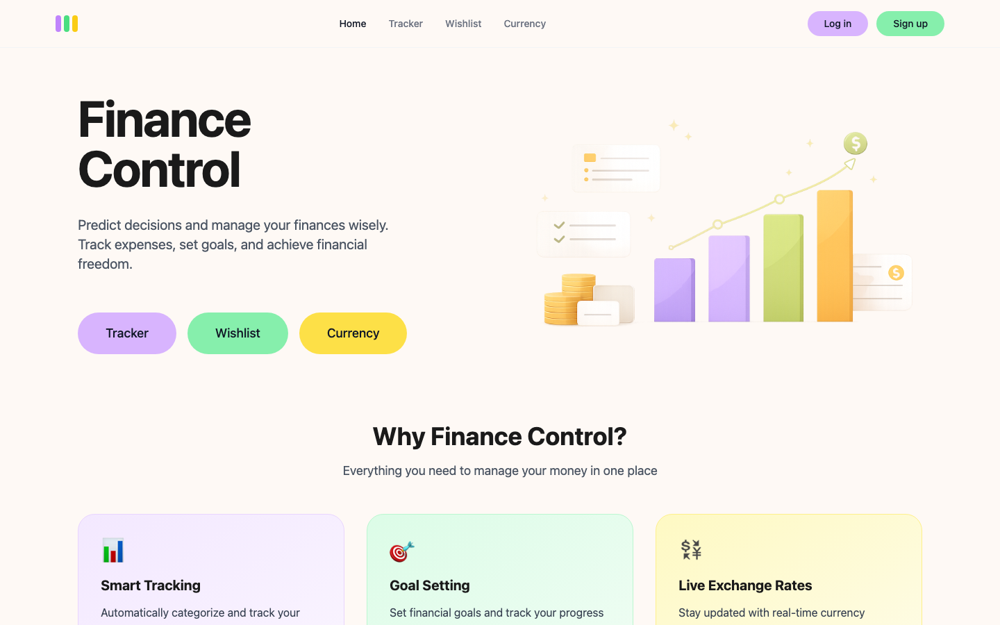
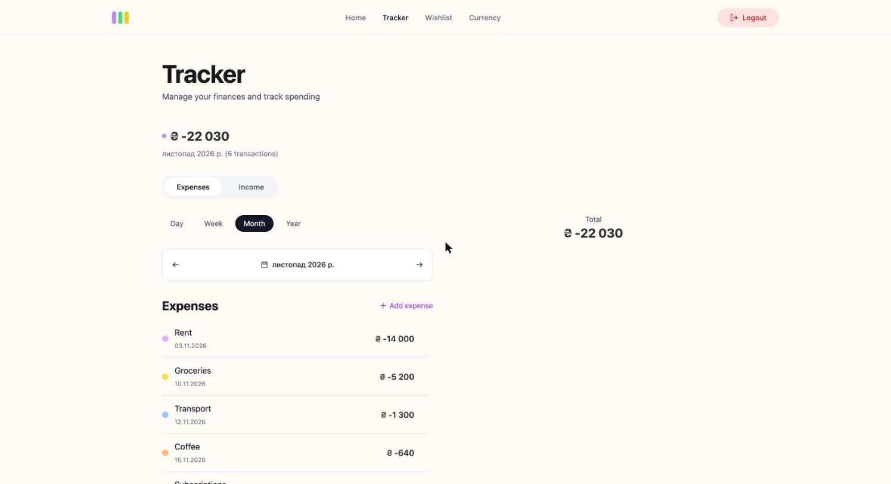
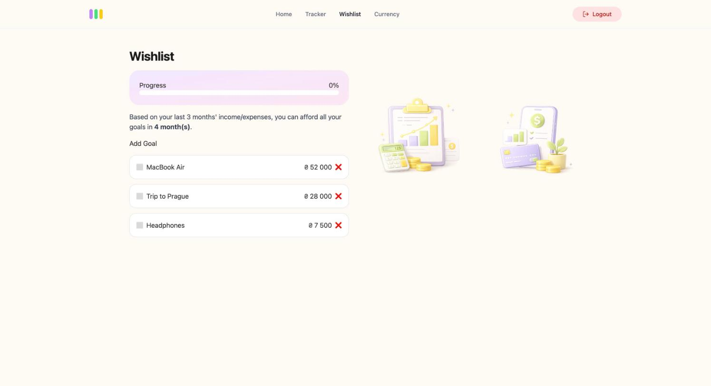
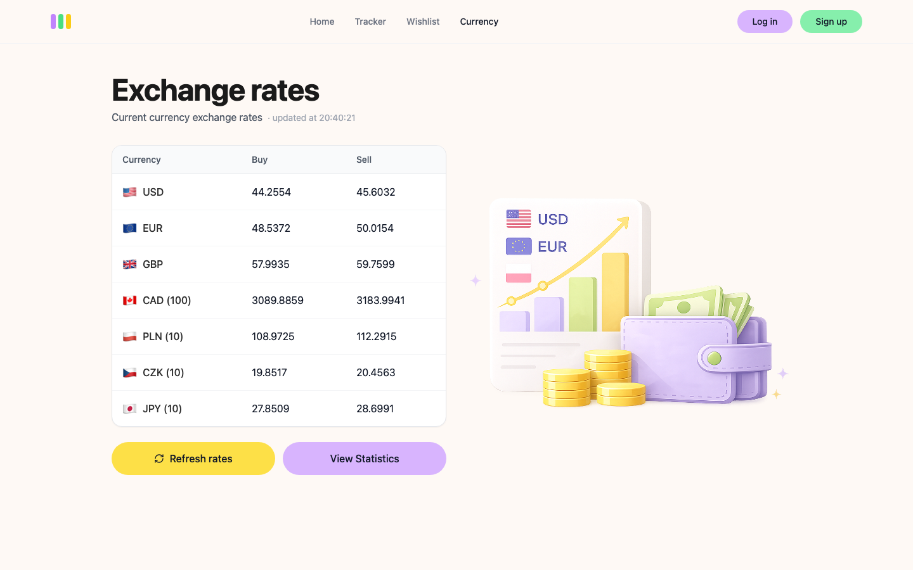
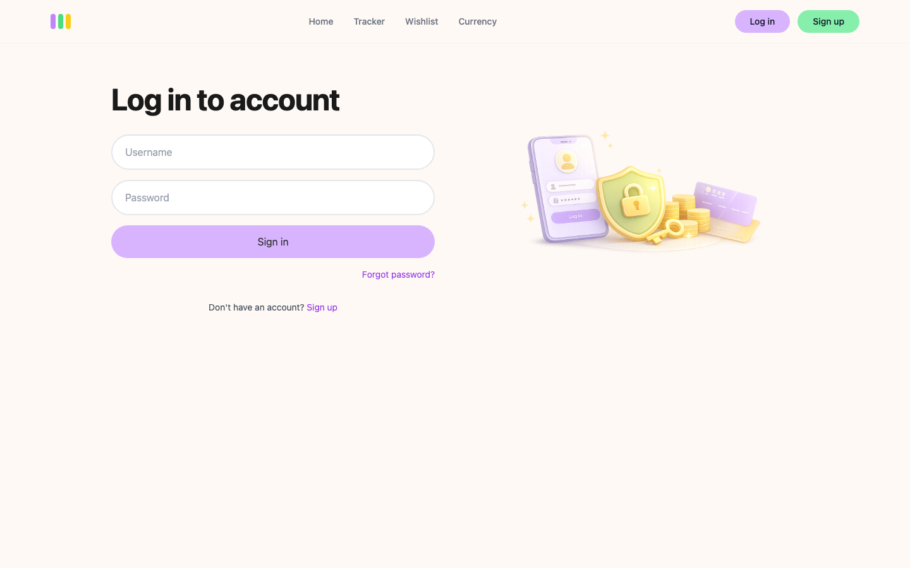
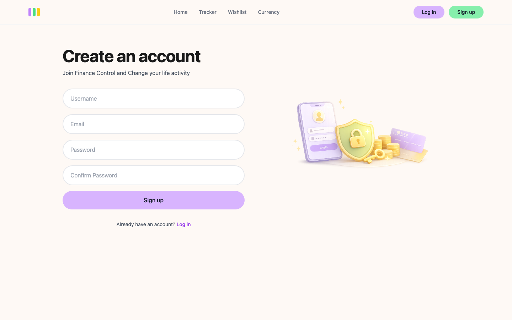

<div align="center">



# 💜 Finance Control

**Predict decisions and manage your finances wisely.**<br>
Track expenses, set goals, and watch live exchange rates — all in one place.

[](https://finance-control-uhfl.onrender.com)


</div>

---

## ✨ Features

| 📊 Smart Tracking | 🎯 Goal Setting | 💱 Live Exchange Rates |
| :--- | :--- | :--- |
| Log income and expenses, browse them by day, week, month or year. | Build a wishlist and see how many months you need to afford every goal. | NBU rates for 7 currencies with a 10-day history. |

## 📸 Screenshots

### Tracker
Manage income and expenses with period filters (day / week / month / year).



### Wishlist
Set financial goals. The progress bar and forecast are based on your last 3 months of income and expenses.



### Currency
Live rates for USD, EUR, GBP, CAD, PLN, CZK and JPY, plus a statistics view.



### Authentication
Sign up / log in with JWT, plus a password reset flow by email code.

<table>
  <tr>
    <td width="50%"></td>
    <td width="50%"></td>
  </tr>
</table>

## 🛠 Tech Stack

| Layer | Technologies |
| :--- | :--- |
| **Backend** | Python 3.13, FastAPI, Uvicorn |
| **Frontend** | React, TypeScript, Vite, Tailwind CSS |
| **Database** | SQLite + SQLModel (SQLAlchemy) |
| **Auth** | OAuth2, JWT (PyJWT), pwdlib (Argon2) |
| **Email** | smtplib (SMTP / TLS) |
| **Currency data** | National Bank of Ukraine, with fallback to exchangerate-api.com and open.er-api.com |

## 🚀 Getting Started

```bash
# 1. Clone
git clone https://github.com/Zavada-Sofiia/finance-control.git
cd finance-control

# 2. Install dependencies
python -m venv .venv && source .venv/bin/activate
pip install -r requirements.txt

# 3. Run the server
uvicorn main:app --reload
```

Open <http://localhost:8000> — the API serves the built frontend from `templates/dist`.
Interactive API docs are available at <http://localhost:8000/docs>.

To work on the frontend:

```bash
cd templates
npm install
npm run dev     # development
npm run build   # rebuild templates/dist
```

Optional `.env` variables for the password reset emails: `SMTP_SERVER`, `SMTP_PORT`, `SMTP_EMAIL`, `SMTP_PASSWORD`.

## 🔌 API Overview

| Method | Endpoint | Description |
| :--- | :--- | :--- |
| `POST` | `/register` | Create an account and get a JWT |
| `POST` | `/token` | Log in (OAuth2 password flow) |
| `POST` | `/forgot-password`, `/reset-password` | Password reset by emailed code |
| `GET` | `/transactions/` | List transactions (pagination, category filter) |
| `GET` | `/transactions/income`, `/transactions/expenses` | Filter by type |
| `POST` | `/transactions/` | Create a transaction |
| `DELETE` | `/transactions/{id}` | Delete your own transaction |
| `GET` | `/balance` | Total balance and transaction count |
| `GET`, `POST` | `/wishlist/` | Wishlist goals |
| `GET` | `/api/currency/rates` | Current exchange rates |
| `GET` | `/api/currency/history` | 10-day rate history |
| `GET` | `/health` | Health check (used by keep-alive) |

Positive amounts are income, negative amounts are expenses.

## 🔐 Security

- Passwords are hashed (Argon2) and never stored in plain text
- JWT tokens carry the user identity and are verified on every protected endpoint
- Users can only read and delete their own data

## 📁 Project Structure

```
finance-control/
├── main.py              # FastAPI server & routes
├── core/                # secret key
├── db/                  # database setup and models
├── schemas/             # Pydantic schemas
├── services/            # currency service, calculator
├── templates/           # React + Vite frontend
│   └── dist/            # built frontend served by FastAPI
├── docs/screenshots/    # images used in this README
├── .github/workflows/   # keep-alive pinger
└── requirements.txt
```

## ⏰ Keep-alive

The demo runs on Render's free tier, which sleeps after ~15 minutes of inactivity. The
[`keep-alive`](.github/workflows/keep-alive.yml) workflow pings `/health` every 10 minutes
to keep it awake.

## 👩‍💻 Team

| | Role |
| :--- | :--- |
| **[Zavada Sofiia](https://github.com/Zavada-Sofiia)** | Backend, login/registration logic, database ↔ frontend connection, auth & security, README |
| **[Zuzuk Polina](https://github.com/pollinariaws)** | Project idea, adaptive design, live currency tracker |
| **[Shlapak Olesia](https://github.com/shlapakolesia)** | Frontend, UI/UX design, Wishlist ↔ Tracker connection, README, presentation |
| **[Denysova Mariia](https://github.com/oryavchik)** | Frontend design, UI/UX design, README, presentation |

🧑‍🏫 Mentor: **[Shymanovskiy Vladislav](https://github.com/VlaDisLav23232)**

<div align="center">

Made with 💜 by the Finance Control team

</div>
